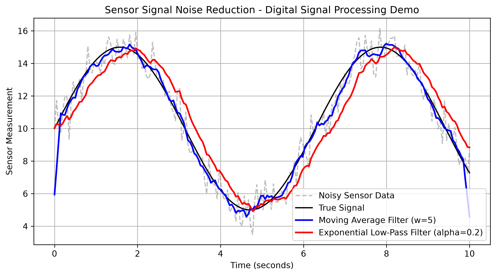

# Sensor Signal Noise Filter (Python / NumPy / Matplotlib)

A Python implementation of Digital Signal Processing (DSP) techniques designed to filter Gaussian noise from simulated sensor telemetry data (such as ultrasonic or radar distance measurements).

## Features
- **Signal Simulation**: Generates a synthetic sinusoidal signal with randomized Gaussian noise.
- **Moving Average Filter**: Reduces high-frequency noise using convolution windows.
- **Exponential Low-Pass Filter**: Implements recursive exponential smoothing for real-time sensor streams.
- **Visualization**: Exports high-resolution comparative plots using `matplotlib`.

## Output Chart


## Technologies Used
- **Language**: Python 3
- **Libraries**: `NumPy`, `Matplotlib`

## How to Run
1. Clone the repository:
   ```bash
   git clone [https://github.com/](https://github.com/)/sensor-signal-filter.git
   